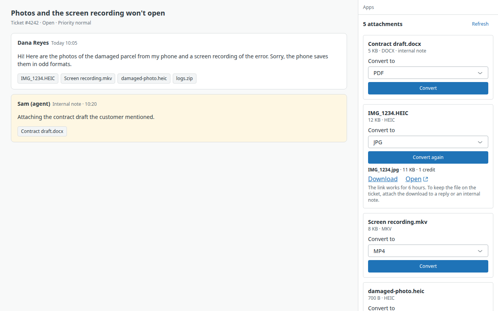
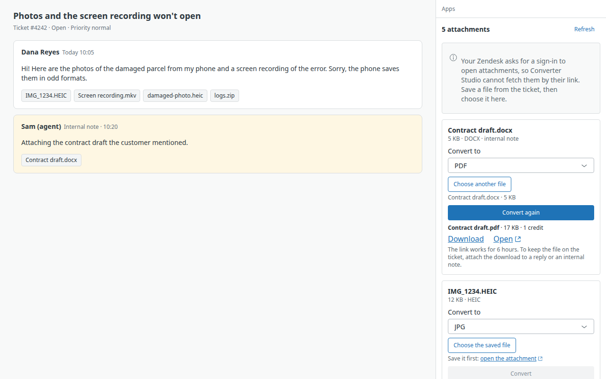

# Converter Studio for Zendesk Support

A ticket sidebar app that converts a ticket's attachments with
[Converter Studio](https://converter.studio): iPhone HEIC photos to JPG, MKV, MOV and AVI videos to
MP4, Word, Excel and PowerPoint files to PDF, PDFs to Word or to a smaller PDF, screenshots and
scans to text, camera RAW photos, ebooks, audio and more than 60 formats in all. The original
attachment is never changed or removed.



## What it does

- Lists the attachments of the ticket you are on (public replies and internal notes, inline images
  included), newest first, with what each can become. The list of formats comes from Converter
  Studio's API, so new conversions show up without an app update.
- Converts the one you pick and shows its progress.
- Gives you the result: **Download**, or **Open** in a new tab for pictures, PDFs, video and audio.
  The link works for 6 hours. To keep the file on the ticket, attach the download to a reply or an
  internal note.
- Follows the agent's light or dark mode.

The app reads the ticket; it never writes to it.

## Install

1. Sign in to [Converter Studio](https://converter.studio) (or create a free account) and make an
   API key on your [account page](https://converter.studio/account#api-keys).
2. Install the app from the Zendesk Marketplace, choose your Zendesk account, and paste the key into
   **Converter Studio API key**.
3. Optionally change **Most credits one conversion may use** (10 by default).
4. Optionally limit the app to some roles or groups, then click **Install**.

## Credits and limits

- Conversions use the Converter Studio account's credits. Most files cost 1 credit; long videos
  cost more. See [plans and credit packs](https://converter.studio/pricing).
- **Most credits one conversion may use** is a hard limit: a conversion priced above it is refused
  and nothing is charged. A conversion that fails is not charged either.
- The largest file depends on the account's plan.
- Results are kept for 6 hours.
- One attachment at a time; the app reads the newest 1,000 comments of a ticket.

## Attachments that need a sign-in

Converter Studio's server downloads an attachment from its Zendesk link. Some accounts require a
sign-in to open attachments (Admin Center, the ticket settings for attachments and downloads, or
private attachments for end users). Then the link does not work for Converter Studio:

- When the account setting is on, the app asks for the saved file from the start: open the
  attachment (your browser is signed in), save it, and choose it in the app. The file then goes from
  your browser to Converter Studio.
- When Zendesk answers the link with its sign-in page anyway, the app notices before anything is
  charged and offers the same.



## Privacy and security

- **What is sent to Converter Studio:** for each conversion an agent starts, the attachment's link
  (Converter Studio downloads that one file) or, when links need a sign-in, the file the agent
  chooses, and the format asked for. Nothing else: no ticket text, no customer or agent details.
  Converter Studio deletes the original once it is converted and the result after 6 hours. See the
  [privacy policy](https://converter.studio/privacy) and the [terms](https://converter.studio/terms).
- **What the app reads in Zendesk**, with the agent's own session: the ticket's comments (for their
  attachments) and one account setting (whether attachments require a sign-in).
- **The API key** is a Zendesk _secure setting_: Zendesk keeps it on its servers and puts it into
  requests to `converter.studio` only, in a header (`domainWhitelist` and `scopes` in the
  manifest). Agents' browsers never receive it. Requests that carry it go through Zendesk's proxy.
- The app's requests name it (`X-Converter-Studio-Client: zendesk/<version>`) so Converter Studio can
  count conversions by integration. It collects no usage data of its own.

## Development

The app follows Zendesk's React scaffold: React 18, [Zendesk Garden](https://garden.zendesk.com)
9, Vite. Node 22.12 or later.

```sh
npm ci
npm run typecheck && npm run lint && npm test   # unit and component tests, no network
npm run build                                   # dist/: manifest.json, translations/, assets/
npm run package                                 # checks dist/, zips it into tmp/
```

To try it in a Zendesk account (a sponsored test account or your own), with
[ZCLI](https://developer.zendesk.com/documentation/apps/getting-started/using-zcli/):

```sh
npx @zendesk/zcli login -i
PRIVATE_APP=1 npm run build
npx @zendesk/zcli apps:validate dist
npx @zendesk/zcli apps:create dist     # later: apps:update dist
```

`zcli apps:server` cannot be used for this app: Zendesk's local app server does not support secure
settings, and the API key is one.

## Support

support@converter.studio · [converter.studio](https://converter.studio) ·
[API documentation](https://converter.studio/developers)

## License

[MIT](LICENSE) © Converter Studio
